# Personajes en Rive: vista previa

Generado por `npm run rive:streetwear -- --previews` (no editar a mano). Así se ven los
personajes de Boom Bap **en el juego**, renderizados desde `assets/rive/<rol>/scene.rml` sobre el
color del escenario. Los conceptos originales están en [`../characters-v1/`](../characters-v1/).

## Cantando

| Kick | Snare | Hi-hat | Bass | Voice | FX |
| :---: | :---: | :---: | :---: | :---: | :---: |
| 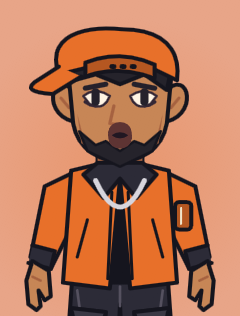 | 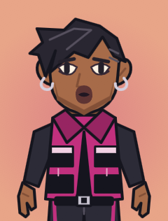 | 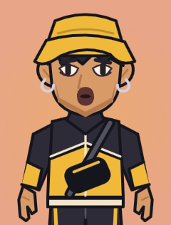 | 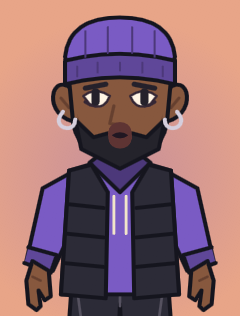 | 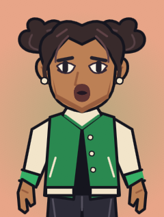 | 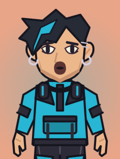 |

## En reposo (sin sonido)

| Kick | Snare | Hi-hat | Bass | Voice | FX |
| :---: | :---: | :---: | :---: | :---: | :---: |
| 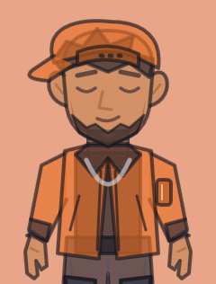 | 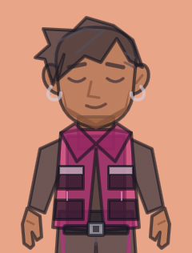 | 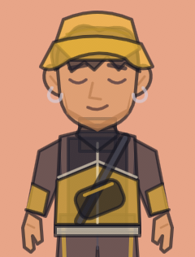 | 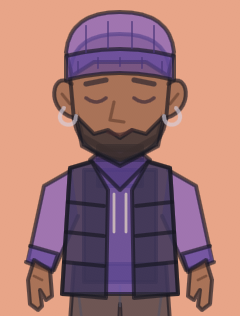 | 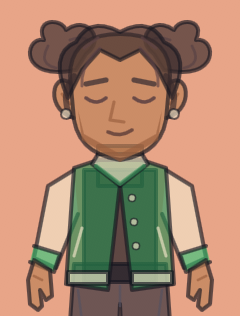 | 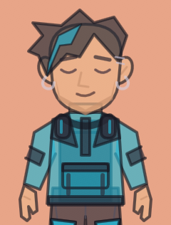 |

## Cómo actualizarlas

1. Editar el arte en `scripts/rive/streetwearArt.ts` (o los colores de rol en `scripts/placeholders/packs.ts`).
2. `npm run rive:streetwear -- --previews` regenera las escenas y estas imágenes (necesita el CLI de Rive, sin iniciar sesión).
3. `npm run rive:streetwear -- --publish --previews` además escribe los `.riv` del juego (necesita `rive login`).
